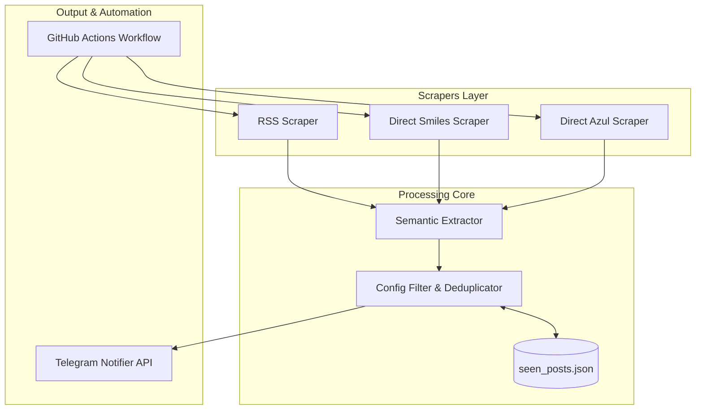

# Bot de Monitoramento de Promoções de Milhas - Implementation Plan

> **For agentic workers:** REQUIRED SUB-SKILL: Use superpowers:subagent-driven-development to implement this plan task-by-task. Steps use checkbox (`- [ ]`) syntax for tracking.

**Goal:** Construir um bot autônomo e sem custos em Python que monitora promoções de transferência de pontos para milhas (Sicredi e demais bancos) e notifica no Telegram a cada hora via GitHub Actions.

**Architecture:** Uma arquitetura modular em Python que combina coleta híbrida (feeds RSS e scrapers diretos resilientes), extração semântica com regex e correspondência de palavras-chave, deduplicação em arquivo JSON local e disparo de mensagens ricas formatadas para o Telegram, orquestrado a cada 1 hora via GitHub Actions com commit automático de estado.

**Architecture Diagram:**

**Tech Stack:** Python 3.11+, `requests`, `feedparser`, `beautifulsoup4`, `pyyaml`, `pytest`, GitHub Actions.

**Spec:** [`docs/specs/2026-11-05-milhas-bot-design.md`](file:///C:/Users/Matheus/.gemini/antigravity/scratch/milhas-monitor-bot/docs/specs/2026-11-05-milhas-bot-design.md)

## Global Constraints

- Compatível com Python 3.10+
- Zero custos operacionais (utiliza GitHub Actions e Telegram Bot API gratuitos)
- Sem vazamento de chaves ou tokens (uso de GitHub Secrets)
- Tratamento resiliente de falhas de rede e bloqueios anti-bot em scrapers diretos
- Execução idempotente com flag `--dry-run` para testes locais

---

### Task 1: Scaffolding, Dependências e Configuração (`config.yaml`)

**Files:**
- Create: `requirements.txt`
- Create: `config.yaml`
- Create: `src/config.py`
- Test: `tests/test_config.py`

**Interfaces:**
- Consumes: Arquivo `config.yaml` e variáveis de ambiente (`TELEGRAM_BOT_TOKEN`, `TELEGRAM_CHAT_ID`)
- Produces: `AppConfig` dataclass com lista de bancos monitorados, feeds RSS, parâmetros de bônus e tokens

- [ ] **Step 1: Escrever teste de carregamento de configuração**
  Criar `tests/test_config.py` validando o carregamento dos bancos configurados, percentual mínimo de bônus e leitura segura de variáveis de ambiente.
- [ ] **Step 2: Executar teste e validar falha**
  Executar `pytest tests/test_config.py` e garantir que falha devido aos arquivos ainda não existirem.
- [ ] **Step 3: Criar `requirements.txt` e `config.yaml`**
  Definir dependências (`feedparser`, `requests`, `beautifulsoup4`, `pyyaml`, `pytest`) e modelo padrão do `config.yaml`.
- [ ] **Step 4: Implementar `src/config.py`**
  Implementar a leitura do YAML e mapeamento para dataclass `AppConfig`.
- [ ] **Step 5: Executar testes e validar sucesso**
  Garantir que `tests/test_config.py` passa 100%.

---

### Task 2: Modelos e Extrator Semântico (`src/extractor.py`)

**Files:**
- Create: `src/models.py`
- Create: `src/extractor.py`
- Test: `tests/test_extractor.py`

**Interfaces:**
- Consumes: Título, link e corpo do texto de notícias brutas (`RawPromotion`)
- Produces: Objeto estruturado `Promotion` (banco de origem, programa de destino, % de bônus, resumo, link, timestamp)

- [ ] **Step 1: Escrever teste para o extrator de promoções**
  Criar casos de teste cobrindo:
  - "Sicredi oferece até 70% de bônus em transferências para a Smiles" -> Origem: Sicredi, Destino: Smiles, Bônus: 70%.
  - "TudoAzul e Livelo: transfira com até 100% de bônus" -> Origem: Livelo, Destino: Azul Fidelidade, Bônus: 100%.
  - Artigos que não são promoções de transferência (devem retornar `None`).
- [ ] **Step 2: Executar teste e validar falha**
  Executar `pytest tests/test_extractor.py`.
- [ ] **Step 3: Implementar `src/models.py`**
  Criar dataclasses `RawPromotion` e `Promotion`.
- [ ] **Step 4: Implementar `src/extractor.py`**
  Construir lógica com regex para identificação de % de bônus, mapeamento de sinônimos de bancos (ex.: "BB" -> "Banco do Brasil") e programas aéreos.
- [ ] **Step 5: Executar testes e validar aprovação**
  Garantir que todos os casos de teste do extrator passem.

---

### Task 3: Notificador do Telegram (`src/notifier.py`)

**Files:**
- Create: `src/notifier.py`
- Test: `tests/test_notifier.py`

**Interfaces:**
- Consumes: Objeto `Promotion` e credenciais (`TELEGRAM_BOT_TOKEN`, `TELEGRAM_CHAT_ID`)
- Produces: Mensagem formatada enviada via endpoint `https://api.telegram.org/bot{token}/sendMessage`

- [ ] **Step 1: Escrever teste unitário com mock para o notificador**
  Criar `tests/test_notifier.py` mockando `requests.post` e testando formatação de mensagem com HTML/Markdown e tratamento de erro HTTP.
- [ ] **Step 2: Executar teste e validar falha**
  Executar `pytest tests/test_notifier.py`.
- [ ] **Step 3: Implementar `src/notifier.py`**
  Criar método `format_message(promo: Promotion) -> str` e `send_notification(promo: Promotion) -> bool`.
- [ ] **Step 4: Executar testes e validar aprovação**
  Garantir que os testes passem com 100% de sucesso.

---

### Task 4: Deduplicação e Filtros de Regra de Negócio (`src/filter.py` e `src/storage.py`)

**Files:**
- Create: `src/storage.py`
- Create: `src/filter.py`
- Test: `tests/test_filter.py`

**Interfaces:**
- Consumes: `Promotion`, `AppConfig` e arquivo `data/seen_posts.json`
- Produces: Lista filtrada de promoções novas a serem disparadas

- [ ] **Step 1: Escrever teste de deduplicação e filtro por banco/bônus**
  Criar testes em `tests/test_filter.py` validando que posts já salvos em `seen_posts.json` são ignorados, e que filtros de banco e bônus mínimo são respeitados.
- [ ] **Step 2: Executar teste e validar falha**
  Executar `pytest tests/test_filter.py`.
- [ ] **Step 3: Implementar `src/storage.py` e `src/filter.py`**
  Persistência simples e atômica de IDs em `data/seen_posts.json` e lógica de filtragem.
- [ ] **Step 4: Executar testes e validar aprovação**
  Validar aprovação de todos os testes de persistência e filtragem.

---

### Task 5: Camada de Coleta Híbrida (`src/scrapers/`)

**Files:**
- Create: `src/scrapers/base.py`
- Create: `src/scrapers/rss_scraper.py`
- Create: `src/scrapers/direct_smiles.py`
- Create: `src/scrapers/direct_azul.py`
- Test: `tests/test_scrapers.py`

**Interfaces:**
- Consumes: URLs de feeds RSS e URLs de páginas diretas
- Produces: Lista de objetos `RawPromotion`

- [ ] **Step 1: Escrever testes com mocks de RSS e HTML direto**
  Criar `tests/test_scrapers.py` mockando retornos de XML de RSS e páginas HTML para verificar extração e tratamento gracioso de HTTP 403 / timeout.
- [ ] **Step 2: Executar testes e validar falha**
  Executar `pytest tests/test_scrapers.py`.
- [ ] **Step 3: Implementar `src/scrapers/base.py` e scrapers**
  Implementar classe abstrata e coletores com headers realistas (`User-Agent`) e tratamento de exceções.
- [ ] **Step 4: Executar testes e validar aprovação**
  Garantir cobertura e resiliência a falhas.

---

### Task 6: Orquestrador Principal CLI (`src/main.py`)

**Files:**
- Create: `src/main.py`
- Test: `tests/test_main.py`

**Interfaces:**
- Consumes: CLI args (`--dry-run`, `--config`)
- Produces: Fluxo completo de ponta a ponta (coleta -> extração -> filtragem -> notificação -> salvamento de estado)

- [ ] **Step 1: Escrever teste do fluxo de ponta a ponta em modo dry-run**
  Criar teste mockando as dependências externas e rodando `main(dry_run=True)`.
- [ ] **Step 2: Executar teste e validar falha**
  Executar `pytest tests/test_main.py`.
- [ ] **Step 3: Implementar `src/main.py`**
  Orquestrar chamadas de scrapers, extratores, filtro, notificador e armazenamento, adicionando logging claro e tratamento de exceções.
- [ ] **Step 4: Executar testes de integração e validar sucesso**
  Garantir que a suíte completa de testes passe com `pytest`.

---

### Task 7: GitHub Actions Workflow e Documentação (`README.md`)

**Files:**
- Create: `.github/workflows/monitor.yml`
- Create: `README.md`
- Create: `.gitignore`

**Interfaces:**
- Consumes: Secrets `TELEGRAM_BOT_TOKEN`, `TELEGRAM_CHAT_ID`
- Produces: Execução cron a cada 1 hora com auto-commit de `data/seen_posts.json`

- [ ] **Step 1: Criar workflow `.github/workflows/monitor.yml`**
  Configurar permissão de escrita de repositório (`permissions: contents: write`), cron a cada hora, checkout, setup do python, instalação de dependências, execução do script e commit automático com `[skip ci]`.
- [ ] **Step 2: Criar `.gitignore`**
  Garantir que ambientes virtuais (`.venv`, `__pycache__`, `.env`) não sejam comitados.
- [ ] **Step 3: Criar `README.md` completo e didático**
  Explicar como criar o bot no Telegram via `@BotFather`, obter o `CHAT_ID`, fazer fork do repositório, adicionar os Secrets no GitHub e rodar localmente.
