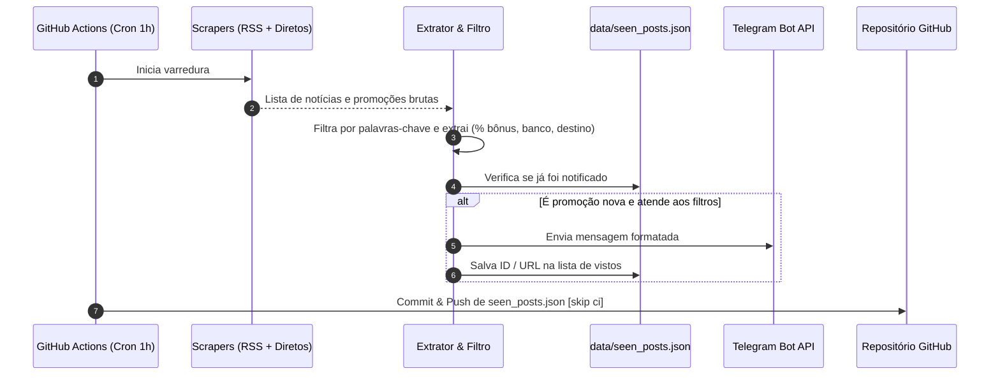

# Especificação de Design: Bot de Monitoramento de Promoções de Milhas e Bancos

- **Data:** 2026-11-05
- **Status:** Proposto (Aguardando Aprovação)
- **Plataformas de Execução:** GitHub Actions (Cron a cada 1 hora) em Repositório Público
- **Canal de Notificação:** Telegram Bot API
- **Linguagem:** Python 3.11+

---

## 1. Visão Geral e Objetivos

O objetivo deste projeto é fornecer um bot automatizado, gratuito e de código aberto para monitorar transferências bonificadas de pontos de cartões de crédito e programas de fidelidade (com foco em **Sicredi**, mas abrangendo **todos os bancos e programas nacionais**) para programas de milhas aéreas (**Smiles, Azul Fidelidade, LATAM Pass, TAP Miles&Go, etc.**).

O sistema roda periodicamente via **GitHub Actions** sem necessidade de servidor próprio, sem custos, e notifica os usuários instantaneamente via **Telegram**.

---

## 2. Requisitos do Sistema

### 2.1 Requisitos Funcionais (RF)
- **RF01 - Coleta Híbrida de Dados:**
  - Camada 1 (RSS): Coleta de feeds RSS especializados (*Melhores Destinos*, *Passageiro de Primeira*, *Pontos pra Voar*).
  - Camada 2 (Direta): Scrapers diretos para páginas públicas de promoções dos programas (*Smiles*, *Azul*, *Livelo*), com resiliência contra bloqueios anti-bot.
- **RF02 - Filtragem e Extração Inteligente:**
  - Identificar se uma notícia/página se refere a uma **transferência bonificada** de pontos para milhas.
  - Extrair metadados:
    - **Origem (Banco/Programa):** Sicredi, Itaú, Bradesco, Santander/Esfera, Banco do Brasil, C6 Bank, Inter, BTG, Nubank, Sicoob, Livelo, etc.
    - **Destino (Programa de Milhas):** Smiles, LATAM Pass, Azul Fidelidade, TAP, Iberia.
    - **Percentual de Bônus:** Identificar bônus (ex.: "70% de bônus", "até 100%").
    - **Link Oficial / Regulamento.**
- **RF03 - Filtro Customizável por Usuário (`config.yaml`):**
  - Permitir filtrar por bancos específicos (ex.: `["sicredi", "livelo"]`) ou monitorar todos (`["all"]`).
  - Permitir definir percentual mínimo de bônus para alerta (ex.: `min_bonus_percentage: 0`).
- **RF04 - Deduplicação Robusta:**
  - Registrar promoções já notificadas em `data/seen_posts.json` por ID canônico / hash normalizado para evitar mensagens duplicadas.
- **RF05 - Notificação via Telegram:**
  - Enviar mensagem formatada em HTML/Markdown com emojis, resumo claro e link direto para cadastro na promoção.
- **RF06 - Persistência sem Servidor:**
  - Ao término da execução no GitHub Actions, atualizar o arquivo `data/seen_posts.json` e commitar as alterações com a tag `[skip ci]`.

### 2.2 Requisitos Não-Funcionais (RNF)
- **RNF01 - Custo Zero:** Executável inteiramente na camada gratuita do GitHub Actions e Telegram.
- **RNF02 - Segurança de Credenciais:** Nenhuma chave em código-fonte; uso estrito de GitHub Repository Secrets (`TELEGRAM_BOT_TOKEN`, `TELEGRAM_CHAT_ID`).
- **RNF03 - Tolerância a Falhas:** Falhas ou bloqueios HTTP 403 em scrapers diretos não interrompem a execução dos feeds RSS.
- **RNF04 - Facilidade de Compartilhamento:** Estrutura pronta para Fork, com documentação clara no `README.md`.

---

## 3. Arquitetura e Componentes

### 3.1 Estrutura de Diretórios
```text
milhas-monitor-bot/
├── .github/
│   └── workflows/
│       └── monitor.yml        # Workflow do GitHub Actions (cron: '0 * * * *')
├── src/
│   ├── scrapers/
│   │   ├── __init__.py
│   │   ├── base.py            # Classe base de scraper
│   │   ├── rss_scraper.py     # Coletor de feeds RSS
│   │   ├── direct_smiles.py   # Coletor direto Smiles
│   │   └── direct_azul.py     # Coletor direto Azul
│   ├── extractor.py           # Parser e regex para banco, destino e % de bônus
│   ├── filter.py              # Aplica regras de config.yaml e deduplicação
│   ├── notifier.py            # Cliente da API do Telegram (sendMessage)
│   └── main.py                # Ponto de entrada CLI e orquestrador
├── data/
│   └── seen_posts.json        # Registro de posts já enviados
├── config.yaml                # Configurações do usuário
├── requirements.txt           # feedparser, requests, pyyaml, beautifulsoup4
├── .gitignore
└── README.md                  # Guia de configuração para novos usuários
```

### 3.2 Diagrama de Fluxo de Dados


---

## 4. Tratamento de Erros e Casos de Borda

1. **Bloqueio Anti-bot (HTTP 403 / Cloudflare) em Scrapers Diretos:**
   - Tratamento com bloco `try/except` específico; log de aviso gerado sem abortar o script.
2. **Post sem percentual explícito de bônus:**
   - O extrator sinaliza `"Bônus promocional"` caso o percentual numérico exato não seja identificado.
3. **Limite de caracteres no Telegram:**
   - Mensagens truncadas de forma limpa caso o título da notícia seja excessivamente longo.
4. **Execução sem novas promoções:**
   - O GitHub Action finaliza com sucesso sem gerar commits vazios no Git (`exit 0`).

---

## 5. Estratégia de Testes

- **Testes Unitários:**
  - Testes do extrator de bônus e detecção de bancos via expressões regulares (`test_extractor.py`).
  - Teste de formatação de mensagens do Telegram (`test_notifier.py`).
  - Teste do sistema de deduplicação (`test_filter.py`).
- **Execução Manual Local:**
  - Script executável localmente via `python -m src.main --dry-run` para testar sem enviar mensagens reais e sem commitar.

---

## 6. Próximos Passos
Após aprovação desta especificação:
1. Criar o plano de implementação detalhado (usando a habilidade `writing-plans`).
2. Implementar os módulos de código com testes unitários.
3. Configurar os workflows do GitHub Actions e o guia de uso no `README.md`.
